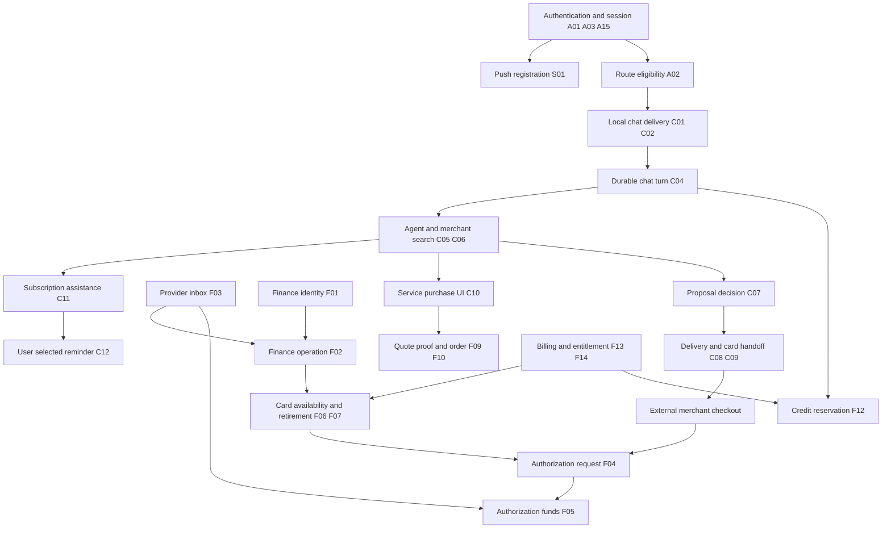

# Existing state machine map

This map describes the current Backend, Mobile, Admin and Web implementation. It groups state by its owner and lifetime so that a screen, a database record and an external provider are not mistaken for one machine. It documents existing behavior; it does not introduce new runtime states or change transition rules.

## Reading the maps

- **Explicit:** a named enum, status or sealed union already represents the relevant state.
- **Implicit:** flags, nullable values, counters, timestamps or control flow represent the state.
- **Mixed:** named states exist, but additional state or transition rules live elsewhere.
- Uppercase identifiers in backticks are persisted status values where specified. Other labels are descriptive abstractions over the implementation.
- Arrows describe supported paths, not permission for arbitrary transitions between every listed state. Guards and failure paths accompany each diagram or table.
- A terminal outcome ends one attempt. It does not necessarily end the aggregate: a failed chat attempt can be retried, and a successful transfer can later be reversed.
- Time is an input: expiry can change effective state before a stored status is updated.

## Domain maps

| Map                                               | Scope                                                                                                                                                                     |
| ------------------------------------------------- | ------------------------------------------------------------------------------------------------------------------------------------------------------------------------- |
| [Chat and shopping](chat.md)                      | C01–C12: message delivery, screen readiness, durable turns, agent/search execution, proposals, checkout, browser, service purchases and subscription assistance/reminders |
| [Identity and access](identity.md)                | A01–A15: session hydration, routing, registration, recovery, OTP/tickets/MFA, passcodes, invitations, account activation and Admin authentication                         |
| [Finance and billing](finance.md)                 | F01–F19: identity provisioning, operations, events, authorization grants and holds, retirement, merchants, service orders, credits, subscriptions and financial UI        |
| [Infrastructure and supporting UI](supporting.md) | S01–S18: push, cache, storage, preferences, processing overlays, AI accounting/alerts, resource requests, support, notifications and public forms                         |

These 64 entries are workflow families, not a count of every flag or screen. Shared request and form machines are mapped once with their concrete implementations. Generated Dart models, static configuration choices and simple visibility/selection toggles are not separate business workflows.

## Relationships between domains

Edges mean dependency or handoff, not a single atomic transaction. In particular, approving a chat proposal does not execute a purchase, approving an authorization permits a matching merchant retry, and client polling is not the authority for payment settlement.

## State ownership and recovery boundaries

| Boundary                                 | Authority                                                                                  | Recovery and exclusion mechanism                                                       |
| ---------------------------------------- | ------------------------------------------------------------------------------------------ | -------------------------------------------------------------------------------------- |
| Local message versus server turn         | Local draft belongs to the Cubit; persisted messages and turn outcome belong to the server | Stable request identity, repository recovery, separate unsent and failed-reply paths   |
| Session versus screen readiness          | SessionCubit owns credentials and hydration; router derives route eligibility              | Boot settlement flag, generation checks, staged nullable fields and redirect priority  |
| Assistant execution versus credit charge | Server turn and credit ledger commit together when completing/releasing an attempt         | Profile row lock, attempt number, lease deadline and ledger references                 |
| Provider call versus financial outcome   | Server ledger plus verified provider observations                                          | Idempotency keys, conditional claims, operation reconciliation and event deduplication |
| Approval versus purchase                 | Approval record grants permission; a later authorization creates a hold                    | Exact merchant/card/currency/amount match, expiry and one-use grant                    |
| Card operation versus retirement         | Operation status tracks an attempt; retirement marker records permanent intent             | Independent provider lifecycle lease, retirement checks and outstanding-hold checks    |
| Screen result versus current account     | Active account/session generation                                                          | Ignore stale async results after logout, account changes or newer requests             |

## Modeling priorities

The largest compound machines are C01–C04, A01–A02, F02–F07 and F09–F15. They combine concurrent work, expiry, recovery and side effects. An eventual refactor should preserve the separate owners shown here rather than create one application-wide status enum.

Existing explicit models should remain visible: SessionState, AuthState, biometric scan phases, card creation steps, card/approval detail unions and database status fields already express part of these workflows. The missing specification is often which event can change them, under which guard, and with which side effect.

## Maintenance

Source links are relative to this sibling-repository workspace. When changing a workflow, update its transition row, recovery rules and connected machines. These diagrams are documentation, not executable transition validation; omission of an edge is not itself a runtime guard.

## Regression coverage for corrected transitions

| Machine           | Protected behavior                                                                                                                     | Regression tests                                                                                                       |
| ----------------- | -------------------------------------------------------------------------------------------------------------------------------------- | ---------------------------------------------------------------------------------------------------------------------- |
| A07 MFA challenge | One atomic consumer obtains a parked session; malformed/replayed challenges are rejected                                               | [MFA tests](../../src/modules/auth/services/mfa-challenge.service.spec.ts)                                             |
| A15 Admin session | Shared refresh, transient-failure preservation, one retry, session-only storage and rejection of late results after logout/replacement | [Admin auth tests](../../../Bonde-Admin/tests/api-client.test.mjs), run with `node tests/api-client.test.mjs` in Admin |
| S03 Offline cache | Concurrent initialization shares one open; failed initialization/open can be retried                                                   | [Cache tests](../../../Bonde-Mobile/test/core/storage/offline_cache_test.dart)                                         |
| S09 Socket        | Handshake readiness, error/close cleanup and protection from superseded connections                                                    | [Socket tests](../../../Bonde-Mobile/test/core/services/socket_service_test.dart)                                      |
