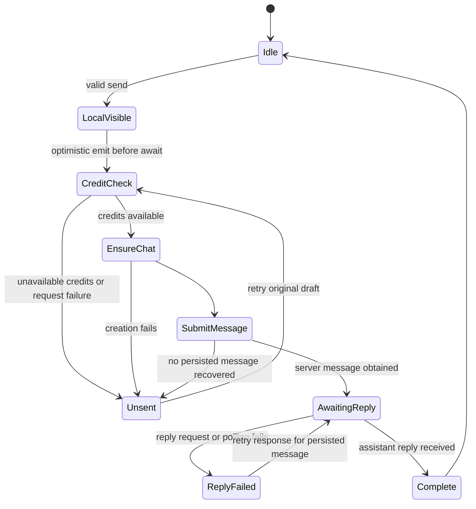
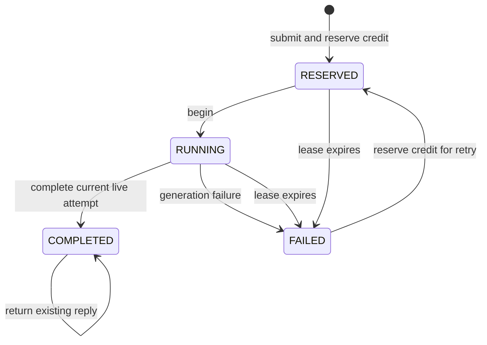
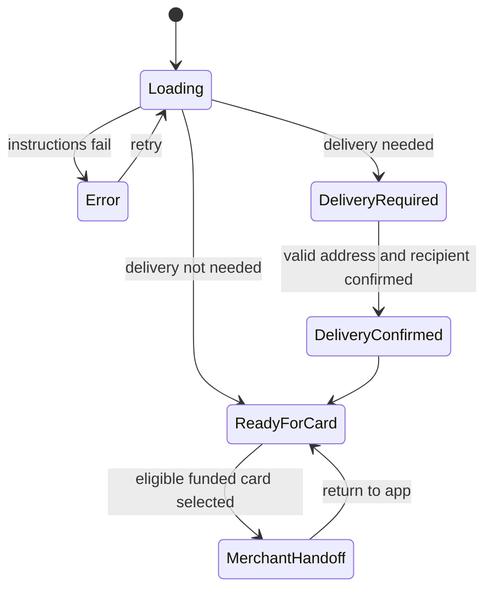
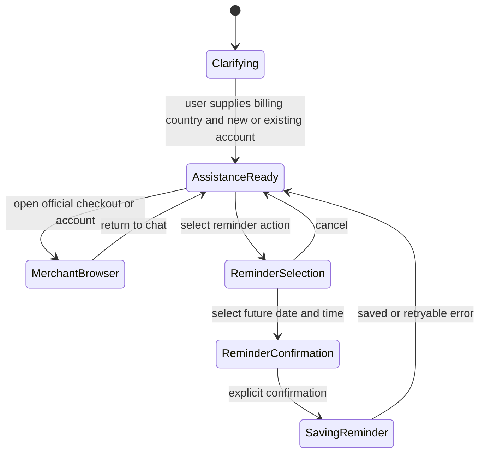

# Chat and shopping state machines

[Map index](README.md)

## C01 Local message delivery

**Implicit; per ChatCubit and message.** State is carried by `loading`, `sending`, `deciding`, `checkingCredits`, message IDs, `_unsent` and `unsentMessageIds`. [ChatCubit](../../../Bonde-Mobile/lib/features/chats/presentation/chat_cubit.dart).

| Event                       | Guard                                                                         | Effect                                                                                             |
| --------------------------- | ----------------------------------------------------------------------------- | -------------------------------------------------------------------------------------------------- |
| Send                        | Trimmed nonempty text, length at most 4,000; not loading, sending or deciding | Create/reuse local message; emit it immediately; mark sending before checking credits              |
| Server acknowledges message | Persisted message identity available                                          | Replace local draft and remove unsent tracking                                                     |
| Failure before persistence  | No confirmed server message                                                   | Keep draft available for resend                                                                    |
| Failure after persistence   | Server message ID known                                                       | Record failed response identity; retry response rather than duplicate the message                  |
| History loaded              | Not superseded by sending                                                     | Merge persisted history with unsent messages; last unanswered user message can become retry target |

Credit checking and proposal decisions are additional dimensions, not sequential states of every message.

## C02 Request recovery and polling

**Implicit; per repository request/message.** [ChatsRepository](../../../Bonde-Mobile/lib/features/chats/data/chats_repository.dart).

| Path                            | Trigger and guard                    | Effect or recovery                                                          |
| ------------------------------- | ------------------------------------ | --------------------------------------------------------------------------- |
| New → submitting                | Send with stable request identity    | Track request and server turn association                                   |
| Submitting → known turn         | POST returns a turn                  | Poll that turn rather than create a second request                          |
| Submitting → recovery           | Response is interrupted or ambiguous | Query existing server outcome using the retained identity                   |
| Known turn → waiting → terminal | Status observations arrive           | Return reply on completion; surface failed turn                             |
| Waiting → locally interrupted   | Polling budget/network fails         | Preserve server identity; client failure does not prove server cancellation |
| Failed response → retry         | Existing persisted message           | Reuse message identity and let server attempt rules decide execution        |

The polling budget is a client observation limit. C04 remains authoritative after it expires.

## C03 Chat screen readiness

**Implicit; per route instance.** [ChatScreen](../../../Bonde-Mobile/lib/features/chats/presentation/chat_screen.dart), [history screen](../../../Bonde-Mobile/lib/features/chats/presentation/chat_history_screen.dart).

| State dimension   | Transitions                                                | Encoding                                              |
| ----------------- | ---------------------------------------------------------- | ----------------------------------------------------- |
| Initial readiness | Enter route → initialize history and credits → ready/error | `_initializing` plus Cubit state                      |
| Sensitive action  | Idle → authenticating → approved/cancelled/error → idle    | `_authenticating` and modal result                    |
| History search    | Input → debounce → request → loaded/empty/error            | Timer, nullable results, error and request generation |

Screen readiness and session readiness are independent. Chat initialization is not a reason to treat the route as unauthenticated.

## C04 Durable server turn

**Mixed; per AiChatTurn attempt.** Persisted states are `RESERVED`, `RUNNING`, `COMPLETED`, `FAILED`; attempt number and lease add hidden substates. [ChatTurnsService](../../src/modules/chats/chat-turns.service.ts), [worker](../../src/modules/chats/chat-worker.service.ts).

| Transition                  | Guard                                                                | Atomic effect                                                                    |
| --------------------------- | -------------------------------------------------------------------- | -------------------------------------------------------------------------------- |
| Submit → reserved           | Owned chat, request key matches content, no other live turn for user | Reserve credit and persist user message/turn under owning profile lock           |
| Reserved → running          | Owned user message, no conflicting running turn                      | Set running lease                                                                |
| Failed → reserved → running | Retry eligible, no other live turn                                   | Increment attempt, reserve credit, clear failure and start lease                 |
| Running → completed         | Same attempt, running status, lease still live, chat exists          | Persist assistant reply, finish credit reservation, set reply ID and clear lease |
| Running → failed            | Same current attempt                                                 | Release reservation and store failure                                            |
| Expired → failed            | Reserved/running lease elapsed                                       | Release reservation through stale-turn recovery/reaper                           |

Late results cannot complete a newer attempt. Repeating completion of an already completed turn returns the existing reply.

## C05 Agent execution

**Implicit; per invocation.** [Shopping agent](../../src/modules/chats/shopping-agent.ts).

| Phase                 | Event or guard                                 | Next phase and effect                                            |
| --------------------- | ---------------------------------------------- | ---------------------------------------------------------------- |
| Model reasoning       | Model requests supported tools; budgets remain | Validate and execute tool calls                                  |
| Tool execution        | Search or quote result arrives                 | Update discoveries/quotes and feed results back to model         |
| Continued reasoning   | More tool work requested within limits         | Another bounded tool iteration                                   |
| Finalization          | Final reply tool/output accepted               | Produce structured reply                                         |
| Budget/error boundary | Call, execution, search or abort limit reached | Stop further work through existing failure/finalization handling |

The discovery map is evidence accumulated during this invocation; it is not a completed purchase.

## C06 Merchant search orchestration

**Implicit; per search key and merchant task.** [ShoppingSearchService](../../src/modules/chats/shopping-search.service.ts).

| State/path                    | Event or guard                                        | Effect                                                         |
| ----------------------------- | ----------------------------------------------------- | -------------------------------------------------------------- |
| Cached                        | Reusable result exists                                | Return without a new merchant search                           |
| In flight                     | Same search already running                           | Join existing promise                                          |
| Queued → fetching             | Merchant concurrency slot and search budget available | Fetch merchant candidates/details                              |
| Candidate → accepted/rejected | Product qualification checks                          | Keep qualified results; omit invalid candidates                |
| Fetching → partial/complete   | Merchant tasks finish or fail                         | Aggregate available results; preserve partial-failure behavior |
| Refresh                       | Cache bypass/invalidation applies                     | Start fresh work; inflight cleanup allows later attempts       |

Cache state, merchant concurrency and candidate qualification are separate dimensions. A single merchant failure does not describe the whole search outcome.

## C07 Proposal decisions

**Mixed; per proposal item.** `PENDING`, `APPROVED`, `DECLINED` live in the reply/approval representation. [ChatRepliesService](../../src/modules/chats/chat-replies.service.ts), [payment instructions](../../src/modules/chats/chat-payment.service.ts), [product card](../../../Bonde-Mobile/lib/features/chats/presentation/widgets/chat_product_card.dart).

| Transition                                     | Guard                                                   | Effect                                                         |
| ---------------------------------------------- | ------------------------------------------------------- | -------------------------------------------------------------- |
| Pending → approving/declining                  | Owned proposal; UI not already deciding                 | Authenticate and submit decision                               |
| Decision submitted → approved/declined         | Server accepts guarded decision                         | Persist decision and associated approval data                  |
| Approving/declining → pending/error            | Authentication cancelled or request fails               | Keep decision retryable through UI handling                    |
| Approved → checkout eligible                   | Both item decision and associated approval are approved | Expose payment instructions                                    |
| Recurring acknowledgement unchecked → accepted | User acknowledges renewal terms                         | Permit the corresponding UI action; reset when product changes |

Proposal approval and F04 card authorization approval are different records and permissions.

## C08 Checkout readiness

**Implicit; per payment route and approved item.** [ChatPaymentScreen](../../../Bonde-Mobile/lib/features/chats/presentation/chat_payment_screen.dart), [ChatPaymentService](../../src/modules/chats/chat-payment.service.ts).

`_payment`, `_cards`, `_address`, `_requiresDelivery`, `_confirmed`, `_error` and `_generation` jointly encode readiness. Reload invalidates confirmation; stale loads must not replace a newer generation. A one-time item address can be stored separately from saved addresses. The merchant/provider confirms any actual purchase, not this screen.

## C09 Merchant browser

**Implicit; per WebView route.** [MerchantBrowserScreen](../../../Bonde-Mobile/lib/features/chats/presentation/merchant_browser_screen.dart).

| Transition                        | Event                                        | Effect                                  |
| --------------------------------- | -------------------------------------------- | --------------------------------------- |
| Initializing → loading → browsing | Controller creation and navigation callbacks | Track host and progress                 |
| Loading/browsing → error          | Relevant navigation failure                  | Display error/reload path               |
| Error → loading                   | Reload                                       | Retry current navigation                |
| Browsing → previous browser page  | Back action with history                     | Navigate WebView history                |
| Browsing → app route              | Exit/return action                           | Leave browser and return control to app |

Browser navigation history and the Flutter route stack are separate state dimensions.

## C10 Service purchase UI

**Mixed; per service quote/order screen.** [ServicePurchaseScreen](../../../Bonde-Mobile/lib/features/chats/presentation/service_purchase_screen.dart).

| Transition                                 | Guard/event                          | Effect                                               |
| ------------------------------------------ | ------------------------------------ | ---------------------------------------------------- |
| Ready → recovering                         | Buy action                           | Look for existing order before another execution     |
| Ready/recovered → authorizing → submitting | Valid quote; passcode proof obtained | Execute with stable request key                      |
| Submitting → pending/terminal              | Server order response                | Retain order identity                                |
| Pending/processing → polling               | Nonterminal order                    | Refresh periodically; `_refreshing` excludes overlap |
| Polling → terminal                         | Success/failure observed             | Stop polling timer                                   |
| Successful → reminder requested/set        | Eligible order and user action       | Persist reminder; reflect `_reminded`                |

`_busy`, `_refreshing`, `_order`, timer and request key supplement the named server order status. F09–F11 own proof, execution and reminder authority.

## C11 Subscription checkout assistance

**Mixed; per AI tool result and chat card.** [Catalogue](../../src/modules/chats/subscription-catalog.ts), [agent](../../src/modules/chats/shopping-agent.ts), [card UI](../../../Bonde-Mobile/lib/features/chats/presentation/widgets/chat_subscription_card.dart).

Only tool-issued IDs can enter the final reply. Prices are `CHECK_AT_CHECKOUT`;
activation is `UNVERIFIED`. This machine has no activated or paid transition.
Mobile rejects unexpected destinations and activation claims. Assistance links
and reminders do not request a passcode because they do not spend money.

Supported services are Netflix, Spotify Premium, YouTube Premium, Apple Music,
Prime Video, Google One, Microsoft 365, Canva Pro and Adobe Creative Cloud.
Provider-specific handoff guidance explains embedded sign-in and original billing
provider limitations. Those gates remain outside Bonde's state authority; the
browser does not automatically launch an external app when a provider requires it.

## C12 Subscription reminder persistence and delivery

**Mixed; per owned source message/card.** [Service](../../src/modules/chats/subscription-reminders.service.ts), [controller](../../src/modules/chats/subscription-reminders.controller.ts), [management UI](../../../Bonde-Mobile/lib/features/chats/presentation/subscription_reminders_screen.dart).

| Transition                             | Guard                                                               | Effect                                                       |
| -------------------------------------- | ------------------------------------------------------------------- | ------------------------------------------------------------ |
| Missing → `SCHEDULED`                  | Owned assistant card; future deadline within one year; active limit | Persist reminder and audit under user lock                   |
| Scheduled/sent/cancelled → `SCHEDULED` | User explicitly schedules again                                     | Upsert source identity with selected deadline                |
| `SCHEDULED → CANCELLED`                | Owned active reminder                                               | Guarded cancellation and audit                               |
| `SCHEDULED → SENT`                     | Due row still matches scanned date/version                          | Conditional claim and in-app notification in one transaction |
| Any → deleted                          | Source message/chat or profile deleted                              | Cascade removes pending work                                 |

Concurrent workers cannot both claim the same version. Stale scans cannot send
after cancellation/rescheduling. Transaction failure rolls back state and
notification together. This is a one-time reminder, not a recurring payment
schedule or activation record.
