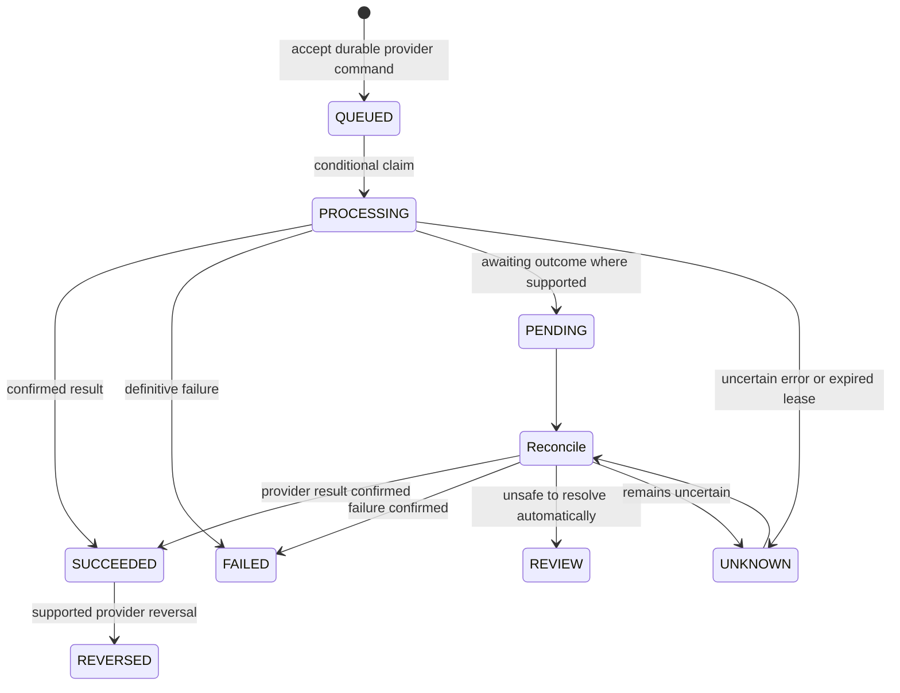
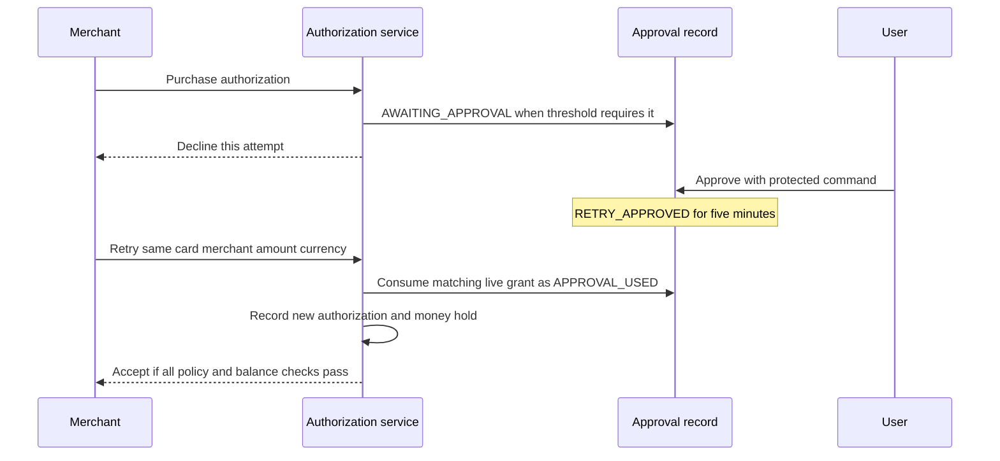
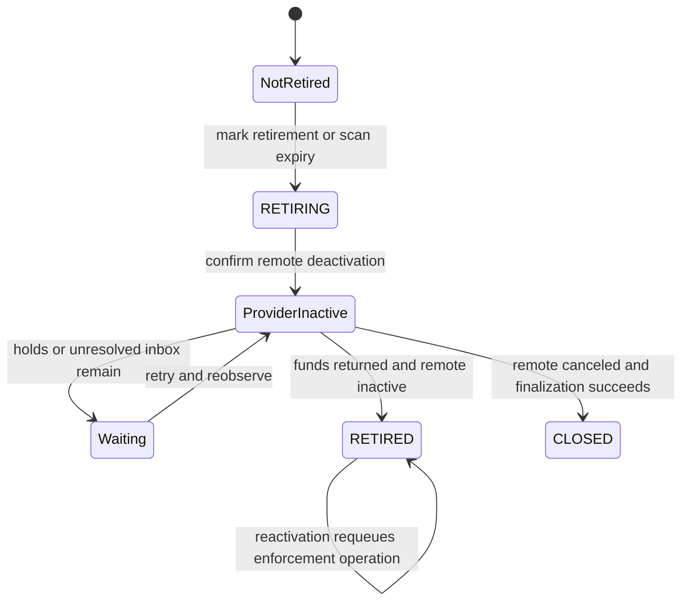
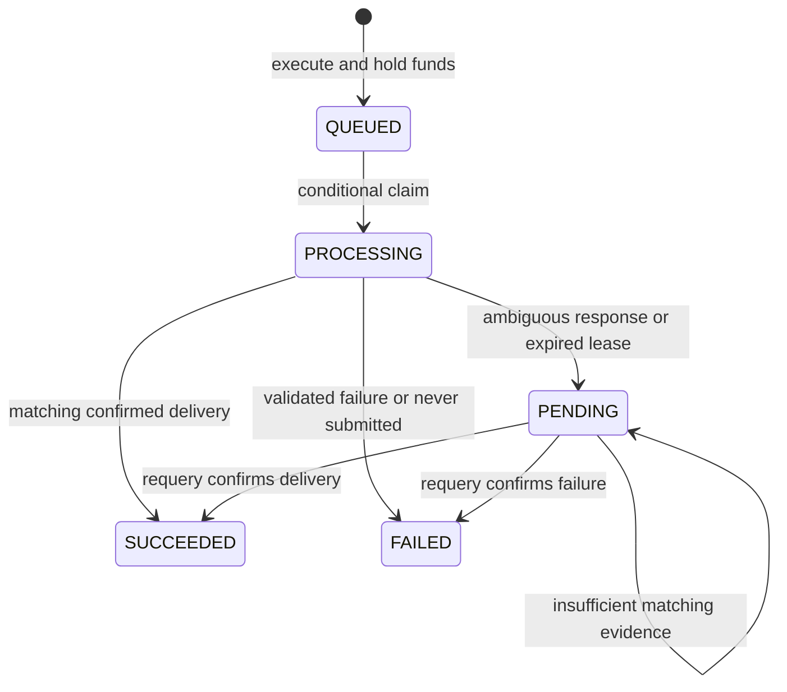
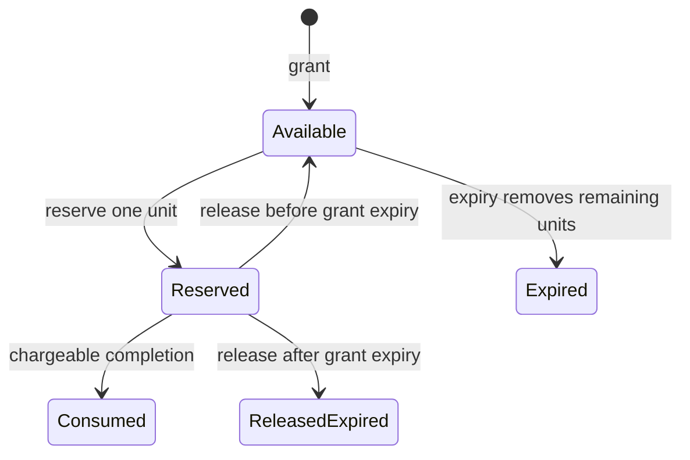

# Finance and billing state machines

[Map index](README.md)

## F01 Finance identity provisioning

**Mixed; per FinanceCustomer.** [FinanceIdentity](../../src/modules/finance/finance-identity.service.ts), [reconciliation](../../src/modules/finance/finance-reconciliation.service.ts).

| Transition                          | Guard/event                                      | Effect                                                |
| ----------------------------------- | ------------------------------------------------ | ----------------------------------------------------- |
| Missing → pending                   | Authorized setup with required identity evidence | Create/claim customer provisioning work               |
| Pending → partially provisioned     | One provider identity/account exists             | Retain provider identifiers for recovery              |
| Partial → ready                     | Required bank and issuer resources confirmed     | Project `READY` status                                |
| Partial/pending → retry             | Provider work interrupted                        | Recover using existing identifiers and guarded claims |
| Existing → reconciled pending/ready | Read actual provider resources                   | Recompute readiness from available provider evidence  |

`PENDING`/`READY` alone do not capture which external resource exists. Claim/lease state excludes overlapping provisioning.

## F02 Finance operation execution

**Mixed; per FinanceOperation.** [Commands and proofs](../../src/modules/finance/finance.service.ts), [FinanceWorker](../../src/modules/finance/finance-worker.service.ts), [events](../../src/modules/finance/finance-events.service.ts).

This diagram is an aggregate of operation kinds. Not every kind supports every edge; `SUPERSEDED` also appears in lifecycle coordination. Local commands can complete synchronously without a provider worker attempt.

| Boundary                    | Guard                                                           | Effect                                                                     |
| --------------------------- | --------------------------------------------------------------- | -------------------------------------------------------------------------- |
| Proof issued                | Server verifies passcode; command payload bound to proof        | Create short-lived authorization                                           |
| Command accepted            | Owned payload, unconsumed unexpired proof, idempotency identity | Consume proof and create operation/ledger changes transactionally          |
| Queue claim                 | Stored status still `QUEUED`                                    | Set `PROCESSING`, increment attempts, lease for 60 seconds                 |
| Definitive provider failure | ProviderError marked definitive                                 | Fail operation; release relevant held funds; update transaction projection |
| Ambiguous provider failure  | Outcome not proven                                              | Mark `UNKNOWN`; do not treat it as confirmed failure                       |
| Worker recovery             | Processing lease elapsed                                        | Mark `UNKNOWN`, then reconcile                                             |
| Retry/reconcile             | Existing operation and provider identity                        | Observe provider truth instead of blindly issuing another money movement   |

Operation status, presentation transaction status, ledger postings and provider state are separate coordinated records.

## F03 Provider event inbox

**Mixed; per inbox event.** [FinanceEvents](../../src/modules/finance/finance-events.service.ts).

| Transition                                              | Event/guard                                 | Effect                                                                                |
| ------------------------------------------------------- | ------------------------------------------- | ------------------------------------------------------------------------------------- |
| Received → attempt                                      | Stored `RECEIVED` or `RETRY` event selected | Resolve provider object and validate event facts                                      |
| Attempt → processed                                     | Authoritative observation accepted          | Apply corresponding ledger/operation/card mutation transactionally with inbox outcome |
| Attempt → retry                                         | Transient or unresolved condition           | Preserve event for later processing                                                   |
| Attempt → review                                        | Definitive provider error in event runner   | Mark event for review                                                                 |
| Duplicate observation → processed/no duplicate mutation | Existing references and guarded settlement  | Preserve idempotent financial effects                                                 |

`OUTSTANDING_HOLDS` can defer a cancellation event. Provider reactivation of a retired card can requeue retirement work rather than make the retirement intent disappear.

## F04 Authorization request and approval grant

**Mixed; per authorization record and a later merchant retry.** [FinanceAuthorizations](../../src/modules/finance/finance-authorizations.service.ts), [approve/decline commands](../../src/modules/finance/finance.service.ts), [approval projection](../../src/modules/transactions/approvals.service.ts).

| Record/path          | Transition                            | Guard/effect                                                                               |
| -------------------- | ------------------------------------- | ------------------------------------------------------------------------------------------ |
| Threshold request    | New → `AWAITING_APPROVAL`             | No valid matching grant; notify user and decline current provider request                  |
| User approval        | `AWAITING_APPROVAL → RETRY_APPROVED`  | Protected approve command; set five-minute expiry                                          |
| User decline         | `AWAITING_APPROVAL → DECLINED`        | Protected decline command                                                                  |
| Grant consumption    | `RETRY_APPROVED → APPROVAL_USED`      | Unused, unexpired, exact matching user/card/merchant/currency/amount                       |
| Grant expiry         | Retry-approved → effectively declined | Approval view checks timestamp even before persisted cleanup                               |
| Policy rejection     | New request → `DECLINED`              | Inactive/retired card, invalid controls, insufficient allocation or other policy rejection |
| Accepted zero amount | New request → `VERIFIED`              | Verification request; no positive money hold                                               |
| Accepted purchase    | New request → `HELD`                  | All policy checks and required grant satisfied                                             |

The grant consumed as `APPROVAL_USED` and the new `HELD` authorization are distinct records. There is no direct purchase-completion edge from user approval.

## F05 Authorization funds lifecycle

**Mixed; per authorization and hold ledger.** [Authorization creation](../../src/modules/finance/finance-authorizations.service.ts), [provider settlement/release](../../src/modules/finance/finance-events.service.ts).

| Logical state/path                 | Event                            | Effect                                                |
| ---------------------------------- | -------------------------------- | ----------------------------------------------------- |
| Available allocation → held        | Accepted positive authorization  | Move card allocation to authorization hold            |
| Held → partially/fully captured    | Validated settlement observation | Apply settlement and update cumulative amounts/status |
| Held → released/declined           | Confirmed release/decline path   | Return eligible unspent hold                          |
| Settled → reversed where supported | Valid provider reversal          | Apply compensating ledger movement                    |

Amount, settled and released counters carry partial-state information. A single status label cannot express all combinations. Duplicate and terminal guards must be read with ledger references; displayed card balance is not an independent settlement authority.

## F06 Card availability and access

**Implicit derived machine.** [FinancePolicy](../../src/modules/finance/finance-policy.service.ts), [CardAccess](../../src/modules/cards/card-access.service.ts), [authorization guards](../../src/modules/finance/finance-authorizations.service.ts).

| Dimension          | State inputs                                                               | Resulting gate                                                      |
| ------------------ | -------------------------------------------------------------------------- | ------------------------------------------------------------------- |
| Provider lifecycle | Card status, issuer resource, pending issue/pause/cancel/retire operations | Whether use/lifecycle action is permitted                           |
| Permanent intent   | `retiredAt`, retirement status and expiry                                  | Prevent further normal use after retirement/expiry                  |
| Policy usage       | Completed/reserved uses, held amounts, rule deadlines and limits           | Controls valid or a blocking reason such as time expiry/usage limit |
| User readiness     | FinanceCustomer ready; owning account active                               | Reject use for unready/suspended account                            |
| Entitlement        | Plan expiry, capacity and current card counts                              | Whether another card can be issued                                  |

These are orthogonal dimensions. `ACTIVE` alone is not equivalent to usable.

## F07 Permanent retirement and provider lease

**Mixed; per card, independent of each operation attempt.** [FinanceRetirement](../../src/modules/finance/finance-retirement.service.ts).

The last edge belongs to the retirement operation, which is requeued while the card's permanent `retiredAt` marker and finalized retirement status remain. `RETIRED` is not necessarily remote cancellation: safe retirement can finish with a paused/inactive provider card.

| Transition/boundary     | Guard                                        | Effect                                                                                        |
| ----------------------- | -------------------------------------------- | --------------------------------------------------------------------------------------------- |
| Mark retirement         | First retirement intent                      | Stamp `retiredAt`, reason and `RETIRING`; enqueue retirement where requested                  |
| Acquire lifecycle lease | No live provider lease                       | Store owner and deadline; serialize provider lifecycle writes separately from operation claim |
| Process                 | Retirement marker and external card ID exist | Read provider truth; deactivate if needed; verify remote result                               |
| Wait                    | Holds/unprocessed related inbox remain       | Keep operation pending rather than finalize prematurely                                       |
| Finalize                | Deactivated provider and safe funds state    | Return remaining allocation, finalize retirement and operation                                |
| Release lease           | Owner matches                                | Clear provider lease in cleanup                                                               |

## F08 Merchant enrollment and catalog publication

**Mixed; separate enrollment, identity and catalog lifetimes.** [FinanceMerchants](../../src/modules/finance/finance-merchants.service.ts), [mobile setup](../../../Bonde-Mobile/lib/features/cards/presentation/merchant_setup_screen.dart), [Admin finance](<../../../Bonde-Admin/src/app/(dashboard)/finance/page.tsx>).

| Machine              | Transitions                                                                        | Guard/effect                                                                                              |
| -------------------- | ---------------------------------------------------------------------------------- | --------------------------------------------------------------------------------------------------------- |
| Enrollment           | None → `PENDING` → `BOUND`/`EXPIRED`                                               | Capture candidate identity; confirm only eligible owned enrollment; deadline invalidates stale enrollment |
| Identity eligibility | Available → revoked                                                                | `revokedAt` prevents further allowed use                                                                  |
| Catalog              | `DRAFT → PUBLISHED → REVOKED`                                                      | Review/publish uses catalog version and merchant evidence                                                 |
| Admin review         | No selection → loading snapshot → reviewed → publishing/revoking → refreshed/error | Selection, snapshot and busy/error encode request phase                                                   |

## F09 Service quote and proof

**Implicit; per immutable quote and scoped proof.** [ServicePurchases](../../src/modules/finance/service-purchases.service.ts).

| Transition                  | Guard                                                | Effect                                                    |
| --------------------------- | ---------------------------------------------------- | --------------------------------------------------------- |
| Quote created → valid       | Service/beneficiary/plan validated                   | Five-minute quote snapshot with amount and fee            |
| Valid → revalidated         | Execution/proof path requests current provider facts | Reject mismatched or unavailable quote facts              |
| Valid quote → proof issued  | Correct server passcode                              | Proof deadline is bounded by two minutes and quote expiry |
| Proof valid → consumed      | Matching owner/quote, unused and unexpired           | Conditional consumption inside order transaction          |
| Quote/proof valid → expired | Time passes                                          | Reject new execution                                      |

Replaying an existing request is resolved against its existing order; it is not permission to reuse a consumed proof for a different purchase.

## F10 Service order execution

**Mixed; per ServiceOrder.** [ServicePurchases](../../src/modules/finance/service-purchases.service.ts).

Processing leases are 60 seconds. A mismatch in reference, amount, beneficiary, category or missing transaction evidence keeps an otherwise terminal supplier response pending. Settlement locks the user, checks terminal state, posts balanced hold settlement/release, updates order and transaction, and records success confirmation where appropriate. A client timeout is not a failure-settlement event.

## F11 Service reminders

**Explicit status with guarded transitions; per reminder.** [Reminder creation/cancellation/delivery](../../src/modules/finance/service-purchases.service.ts).

Successful order → scheduled reminder. `SCHEDULED → CANCELLED` on owned cancellation, or `SCHEDULED → SENT` when due. The due runner claims the scheduled row transactionally and creates the notification. No intermediate persisted sending status is required by this implementation.

## F12 AI credit grants and reservations

**Implicit ledger/counter machine; per account, grant and turn attempt.** [AiCreditsService](../../src/modules/billing/ai-credits.service.ts).

These are unit-level states; one grant can have both remaining and reserved units. Initialization backfills legacy counters once, guarded by `ledgerInitialized`. Reservation prioritizes plan, welcome, then purchased grants. The owning profile row is locked by callers. Finishing a reservation decrements reserved units and records consume/release/release-expired; expired released units do not become spendable again. C04 supplies attempt identity and coordinates completion/release.

## F13 Billing order

**Mixed; per BillingOrder.** [BillingService](../../src/modules/billing/billing.service.ts).

| Transition                  | Guard/event                                   | Effect                                                                         |
| --------------------------- | --------------------------------------------- | ------------------------------------------------------------------------------ |
| New → `PENDING`             | Valid product/method and idempotency identity | Persist order                                                                  |
| Pending → `SUCCESS`         | Confirmation/renewal settlement accepted      | Charge supported funding route, grant purchased benefit and update transaction |
| Pending → `FAIL`            | Confirmed settlement failure                  | Record failure reason                                                          |
| Pending → `CANCELLED`       | Cancellation or applicable settlement guard   | Prevent further normal settlement                                              |
| Existing → existing outcome | Repeated identity/terminal confirmation       | Reuse guarded order result                                                     |

Billing uses `FAIL`, whereas ServiceOrder uses `FAILED`. Transaction status is another projection; do not normalize them into one undocumented status vocabulary.

## F14 Subscription and renewal

**Implicit; per profile and billing period.** [BillingService](../../src/modules/billing/billing.service.ts), [renewal scheduler](../../src/modules/billing/billing-renewal.service.ts).

| Effective state/path           | Inputs/event                                       | Effect                                                                 |
| ------------------------------ | -------------------------------------------------- | ---------------------------------------------------------------------- |
| Free/expired → active          | Successful premium purchase                        | Set entitlement expiry and associated credits                          |
| Active → renewal due           | Period end reached; recurring arrangement eligible | Create/reconcile period-specific renewal work                          |
| Renewal due → active           | Successful renewal                                 | Advance entitlement period                                             |
| Active → cancel at period end  | User cancellation                                  | Set cancellation preference; entitlement continues through paid expiry |
| Cancel at period end → expired | Paid period ends                                   | No continuing paid entitlement                                         |

Card-plan expiry, `billingCancelAtPeriodEnd`, mandate/offer eligibility and prior successful orders jointly determine the effective state. The scheduler's `running` flag only controls overlapping ticks, not subscription status.

## F15 Mobile billing purchase and recovery

**Implicit; per purchase screen plus persisted preference.** [PurchaseScreen](../../../Bonde-Mobile/lib/features/profile/presentation/purchase_screen.dart), [plan consent](../../../Bonde-Mobile/lib/features/profile/presentation/plan_screens.dart), [method picker](../../../Bonde-Mobile/lib/features/profile/presentation/payment_method_screens.dart).

| Transition                            | Guard/event                             | Effect                                                              |
| ------------------------------------- | --------------------------------------- | ------------------------------------------------------------------- |
| Enter → restored/new identity         | Saved purchase preference exists or not | Recover request key, order ID and method                            |
| Pay → reconcile existing order        | Order ID known                          | Read outcome before attempting another payment                      |
| Ready → pending order                 | No reusable pending order               | Create using stable key; persist recovery data                      |
| Pending → biometric → passcode        | User confirmation succeeds              | Confirm server order                                                |
| Result → success/failure presentation | Server response                         | Refresh benefits/balance on success; display result sheet           |
| Failure → retry/change method         | User result action                      | Clear appropriate local order/method state and reenter payment path |

`busy`, `presentingResult`, selected method/card, order object and saved identity are independent state dimensions. Closing authentication is not proof a charge occurred.

## F16 Card creation and optimistic management

**Mixed; per Cubit/screen.** [Creation](../../../Bonde-Mobile/lib/features/cards/create_card_cubit.dart), [detail](../../../Bonde-Mobile/lib/features/cards/cards_detail_cubit.dart), [rule editing](../../../Bonde-Mobile/lib/features/cards/edit_card_rules_cubit.dart).

| Flow               | Transitions                                                             | Guard/recovery                                                                                             |
| ------------------ | ----------------------------------------------------------------------- | ---------------------------------------------------------------------------------------------------------- |
| Creation           | Access check → details → rules → review → protected submission → result | Explicit step plus checkingAccess/access/isSubmitting/error; server remains entitlement/issuance authority |
| Detail loading     | Initial → loading → loaded/failure                                      | Fan out owned card subresources                                                                            |
| Lifecycle mutation | Loaded → optimistic pause/resume → confirmed/rollback                   | Preserve previous record for failure recovery; terminal destroy path handled separately                    |
| Rule editing       | Load → edit → submit → saved/error                                      | Validate configured rule and protected command path                                                        |

## F17 Beneficiary, deposit and withdrawal UI

**Implicit; per wallet route.** [Wallet flow screens](../../../Bonde-Mobile/lib/features/wallet/presentation/wallet_flow_screens.dart), [bank verification](../../src/modules/funding/bank-accounts.service.ts).

| Flow                 | Transitions                                                                              | Guard/effect                                                                                   |
| -------------------- | ---------------------------------------------------------------------------------------- | ---------------------------------------------------------------------------------------------- |
| Beneficiary          | Bank/account input → resolving → resolved → saved                                        | Revision excludes stale resolution; server re-resolves before persisting verified bank details |
| Deposit instructions | Loading → amount/details → done/refresh                                                  | Display verified deposit account; screen completion does not itself settle a deposit           |
| Withdrawal           | Validate → amount/fee confirmation → passcode proof → submit → observe/recover → receipt | Stable request key/proof; busy state blocks unsafe duplicate action/back navigation            |

F02 and F03 settle actual bank movement.

## F18 Secure card display

**Implicit; per short-lived display session and WebView route.** [Display authorization](../../src/modules/finance/finance.service.ts), [SecureCardScreen](../../../Bonde-Mobile/lib/features/finance/secure_card_screen.dart).

Authorized display session → secure view loading → visible/error → hidden/closed. The route hides on any non-resumed app lifecycle state or after 90 seconds, blanks the view, and clears WebView cache/local storage on disposal. Navigation is constrained by main-frame and allowed-host checks. This is separate from card lifecycle and does not provide a raw credential API to native code.

## F19 Installation and setup readiness

**Implicit; installation is persistent, setup UI is per route.** [Installation guard](../../src/modules/finance/finance-installation.service.ts), [capabilities](../../src/modules/finance/finance-capabilities.service.ts), [setup screen](../../../Bonde-Mobile/lib/features/finance/finance_setup_screen.dart).

| Machine                | Transitions                                                                           | Guard/effect                                                                                    |
| ---------------------- | ------------------------------------------------------------------------------------- | ----------------------------------------------------------------------------------------------- |
| Installation           | Uninitialized → environment bound                                                     | First enabled finance/service startup creates immutable environment marker                      |
| Environment validation | Bound → accepted/startup rejected                                                     | Configured environment must match stored environment; disabled integrations skip initialization |
| Capability/setup UI    | Loading → unavailable/identity required/bank setup/issuer readiness → refreshed/error | Capability/customer payload plus busy/error determines available action                         |

Capability disabled is a gate, not permission to fabricate a ready provider resource.
