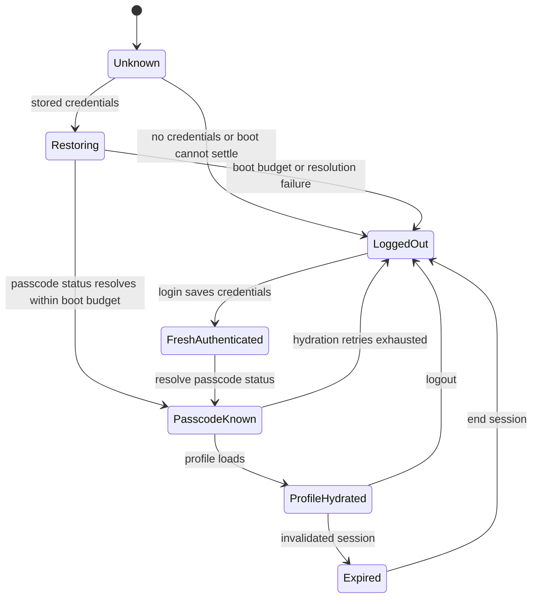
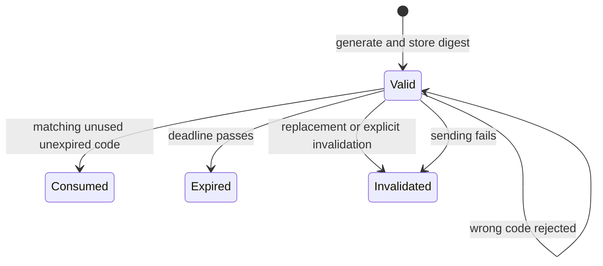
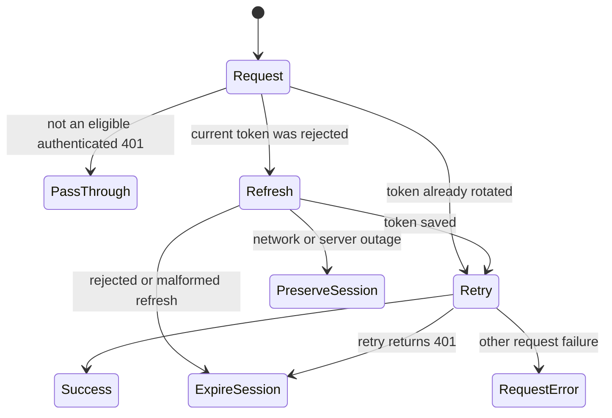

# Identity and access state machines

[Map index](README.md)

## A01 Mobile session and hydration

**Mixed; per application session.** Outer states are `unknown`, `loggedOut`, `authenticated`, `sessionExpired`. Authenticated contains nullable `passcodeSet`/`user`, `passcodeUnlocked` and `isRestoredSession`. [SessionState](../../../Bonde-Mobile/lib/core/models/session_state.dart), [SessionCubit](../../../Bonde-Mobile/lib/features/auth/presentation/session_cubit.dart).

Restoring and hydration labels are logical substates, not additional SessionState variants. Passcode interaction and profile loading can overlap after the blocking boot work ends.

| Event                 | Guard                                                                  | Effect                                                                                                                          |
| --------------------- | ---------------------------------------------------------------------- | ------------------------------------------------------------------------------------------------------------------------------- |
| Fresh login           | Current generation; tokens persisted                                   | Emit authenticated with unknown passcode status, fresh-login flag and unlocked passcode; settle remaining fields asynchronously |
| Restored session      | Tokens present and blocking boot resolves                              | Resolve passcode gate, then hydrate profile                                                                                     |
| Late async completion | Same generation, not closed, boot not already superseded where checked | Apply result; otherwise ignore                                                                                                  |
| Boot timeout          | Blocking boot has not settled within eight seconds                     | End boot rather than let a late result resurrect it                                                                             |
| Hydration failure     | Three profile attempts exhausted                                       | End unusable session                                                                                                            |
| Logout/expiry         | Session ending                                                         | Clear session data and invalidate outstanding work; synchronize push cleanup                                                    |

Unknown passcode/profile information is not the same as a known unmet requirement.

## A02 Route eligibility

**Implicit derived machine; evaluated on navigation/session changes.** [Router](../../../Bonde-Mobile/lib/core/router/app_router.dart), [onboarding gate](../../../Bonde-Mobile/lib/core/router/onboarding_gate.dart).

| Effective gate              | Input/priority                            | Allowed transition                                        |
| --------------------------- | ----------------------------------------- | --------------------------------------------------------- |
| Authentication unresolved   | Session unknown/restoring                 | Loading route until blocking session decision             |
| Logged out or expired       | No usable authenticated session           | Public/auth routes                                        |
| Passcode locked             | Authenticated and requires unlock         | Unlock route precedes downstream onboarding gates         |
| Passcode status unknown     | `passcodeSet == null`                     | Wait for resolution; do not infer setup is missing        |
| Passcode setup required     | `passcodeSet == false`                    | Passcode setup route                                      |
| Profile unresolved          | Passcode known, `user == null`            | Hydration/loading handling; do not infer unverified email |
| Email verification required | Known passcode and known unverified email | Email verification route                                  |
| Ready                       | Required gates resolved                   | Application shell                                         |

Owned routes prevent a gate from redirecting away from the screen that resolves it. Phone verification is not a returning-user onboarding redirect; biometrics is a prompt rather than a persistent onboarding gate.

## A03 Registration and login orchestration

**Mixed; per auth attempt.** [Backend AuthService](../../src/modules/auth/services/auth.service.ts), [provisioning](../../src/modules/auth/services/user-provisioning.service.ts), [mobile AuthBloc](../../../Bonde-Mobile/lib/features/auth/data/auth_bloc.dart), [AuthState](../../../Bonde-Mobile/lib/features/auth/data/auth_state.dart).

| Transition                              | Guard/event                                 | Effect                                                                                                        |
| --------------------------------------- | ------------------------------------------- | ------------------------------------------------------------------------------------------------------------- |
| Registration input → unverified profile | Provider registration succeeds              | Create profile; issue registration ticket and verification flow                                               |
| Unverified → verified and provisioned   | Correct verification proof and valid ticket | Atomically mark verified and create account/wallet; consume registration ticket after protected work succeeds |
| Credentials → session                   | Password valid; no second factor            | Adopt provider session                                                                                        |
| Credentials → MFA challenge             | Password valid; factor enabled              | Park provider session; return challenge rather than usable tokens                                             |
| MFA challenge → session/rejected        | Challenge consumed and code checked         | Release session only after accepted factor; failed challenge requires fresh login                             |
| Authenticated → hydrated application    | Client adopts session                       | Hand off to A01/A02                                                                                           |

AuthState already names loading, success, verification requirements, two-factor requirement, reset token and failure states. The cross-route orchestration remains spread across Bloc, SessionCubit and router.

## A04 Password recovery and change

**Mixed; per recovery attempt.** [AuthService](../../src/modules/auth/services/auth.service.ts), [tickets](../../src/modules/auth/services/auth-tokens.service.ts), [security screens](../../../Bonde-Mobile/lib/features/profile/presentation/security_screens.dart).

| Path                                | Guard                                             | Side effect/recovery                               |
| ----------------------------------- | ------------------------------------------------- | -------------------------------------------------- |
| Reset requested → OTP verification  | Public recovery request accepted                  | Generic response avoids exposing account existence |
| OTP accepted → reset ticket ready   | Valid single-use recovery proof                   | Issue ticket for password-reset operation          |
| Reset ticket → password updated     | Ticket valid and provider update succeeds         | Consume ticket after success                       |
| Failure → retry/input               | Invalid proof, expired ticket or provider failure | Follow the relevant OTP/ticket retry boundary      |
| Signed-in password change → updated | Current password reverified                       | Update password and revoke other sessions          |

## A05 OTP lifecycle

**Implicit; per issued code.** [OtpService](../../src/modules/otp/otp.service.ts).

The record's digest, used/expiry fields encode state. Sending a new code invalidates earlier codes; delivery failure voids the newly generated credential. Channel and purpose scope the protected verification flow.

## A06 Registration and reset tickets

**Implicit; per signed ticket plus Redis nonce.** [AuthTokensService](../../src/modules/auth/services/auth-tokens.service.ts).

| State/path       | Event and guard                            | Effect                                                  |
| ---------------- | ------------------------------------------ | ------------------------------------------------------- |
| Issued → valid   | Signed purpose-bound token with live nonce | Protected operation can verify it                       |
| Valid → valid    | Verification only                          | No consumption; failed protected work remains retryable |
| Valid → consumed | Protected operation succeeds, then consume | Delete nonce                                            |
| Valid → expired  | Token/nonce TTL elapses                    | Reject later use                                        |

Ticket validity is split between JWT validation and Redis presence. A verify helper is not a consume helper.

## A07 MFA challenge and factor enrollment

**Implicit/mixed; separate challenge and enrollment lifetimes.** [MFA challenge](../../src/modules/auth/services/mfa-challenge.service.ts), [two-factor service](../../src/modules/auth/services/two-factor.service.ts), [Admin setup](../../../Bonde-Admin/src/components/account/two-factor-card.tsx).

| Machine           | Transitions                                        | Guard/effect                                                                                      |
| ----------------- | -------------------------------------------------- | ------------------------------------------------------------------------------------------------- |
| Parked login      | Created → consumed/expired                         | Five-minute challenge; consumption is one-use, including a failed verification attempt            |
| Factor enrollment | Disabled → secret provisioned → enabled → disabled | Password verification starts setup; valid code enables; disabling requires protected confirmation |
| TOTP replay       | Current step unused → used                         | `lastUsedStep` prevents accepting a step again                                                    |
| Recovery code     | Available → consumed                               | Remove matched stored hash after use                                                              |
| Admin setup UI    | Closed → password → scan → verify → codes          | Explicit step union plus setup data, busy/error and one-time recovery-code display                |

The UI setup state is not proof that the server factor is enabled.

Challenge consumption uses Redis `GETDEL`, so retrieval and deletion are one atomic operation. Concurrent attempts cannot both obtain the parked session. Invalid payloads remain consumed and are rejected.

## A08 Server passcode and lockout

**Implicit; per user.** [PasscodeService](../../src/modules/passcode/passcode.service.ts).

| Transition                      | Guard                  | Effect                            |
| ------------------------------- | ---------------------- | --------------------------------- |
| Unconfigured → configured       | Valid creation request | Store passcode hash               |
| Unlocked → failed-attempt state | Wrong passcode         | Increment failure count           |
| Failed-attempt state → locked   | Threshold reached      | Set `lockedUntil`                 |
| Locked → usable                 | Lock deadline elapsed  | Permit verification again         |
| Usable → verified               | Correct passcode       | Clear failure counters/lock state |

Verification success is an event, not an indefinitely authorized session for every financial command.

## A09 Passcode UI and change flow

**Mixed; per screen/modal.** [Entry](../../../Bonde-Mobile/lib/features/passcode/presentation/enter_passcode_screen.dart), [setup](../../../Bonde-Mobile/lib/features/passcode/presentation/passcode_setup_screen.dart), [security screens](../../../Bonde-Mobile/lib/features/profile/presentation/security_screens.dart).

| Flow             | Transitions                                               | Additional state                                                |
| ---------------- | --------------------------------------------------------- | --------------------------------------------------------------- |
| Unlock           | Input → submitting → error/success → navigation           | Entered digits, error/success flags; duplicate submit exclusion |
| Setup            | Create → confirm → submitting → created; mismatch → retry | Explicit step plus original digits and busy/error flags         |
| Change           | Verify old → enter new → confirm → save                   | Old verification result carried across modal stages             |
| Biometric prompt | Passcode success/setup → prompt → accepted/declined       | Prompt outcome is separate from whether passcode exists         |

## A10 Server session validity

**Implicit; per AuthSession.** [AuthSessionsService](../../src/modules/auth/services/auth-sessions.service.ts).

Active status derives from expiry and revocation fields. Login/refresh records a session; logout, device revocation or password change can revoke it. Provider refresh and server checks enforce eligibility. Revocation does not imply every already-issued access token instantly disappears from a device.

## A11 Mobile access token refresh

**Implicit; per refresh flight and failed request.** [TokenRefreshInterceptor](../../../Bonde-Mobile/lib/core/network/token_refresh_interceptor.dart).

Concurrent refresh work shares `_refreshing`. Before saving a refresh result, the interceptor verifies that the stored refresh token still belongs to that session. A failed retry is distinguished from a failed refresh.

## A12 Invitation acceptance

**Implicit; per UserInvite.** [InvitesService](../../src/modules/invites/invites.service.ts).

| Transition          | Guard/event                                    | Effect                                                          |
| ------------------- | ---------------------------------------------- | --------------------------------------------------------------- |
| Issued → pending    | Invitation email sent                          | Retain token digest and expiry                                  |
| Issued → removed    | Email delivery fails                           | Delete unusable invitation                                      |
| Pending → revoked   | Admin revocation or replacement invitation     | Stamp revocation                                                |
| Pending → expired   | Time passes                                    | Effective status changes without requiring a stored enum update |
| Pending → claimed   | Valid unaccepted, unrevoked, unexpired token   | Conditional `acceptedAt` update excludes competing acceptance   |
| Claimed → accepted  | Provider creation and provisioning succeed     | Complete user creation                                          |
| Claimed → retryable | Acceptance failure where claim release applies | Release claim through failure handling                          |

Claimed and accepted share timestamp-based encoding during processing; they are distinct logical phases. Display status is derived from accepted/revoked/expiry fields.

## A13 Email change and profile verification

**Implicit; per profile/provider identity.** [EmailChangeService](../../src/modules/profile-hub/email-change.service.ts), [ProfilesService](../../src/modules/profiles/profiles.service.ts), [KYC projection](../../src/modules/kyc/kyc.service.ts).

Current email → validated change request → provider pending confirmation → confirmed provider email → local profile synchronized. Changing a profile phone clears its verification flag. KYC read status is a derived verified/pending projection; it should not be mistaken for an independently orchestrated verification job in KycService.

## A14 Account activation and biometric enrollment

**Implicit derived status/simple record lifecycles.** [Admin users](../../src/modules/admin-console/admin-console-users.service.ts), [biometric devices](../../src/modules/biometrics/biometrics.service.ts).

| Aggregate        | States and events                                                                          | Encoding                                                                                                           |
| ---------------- | ------------------------------------------------------------------------------------------ | ------------------------------------------------------------------------------------------------------------------ |
| Account access   | Pending → active after verification/provisioning; active ↔ suspended through admin actions | Profile verification plus account/wallet `isActive`; suspended projection takes precedence when either is inactive |
| Biometric device | Absent → enrolled → active/inactive → removed                                              | Device row presence and `isActive`; local enrollment metadata is separate from server cryptographic authentication |

## A15 Admin authentication and refresh

**Mixed; per browser session/request.** [AuthProvider](../../../Bonde-Admin/src/lib/auth/auth-provider.tsx), [API client](../../../Bonde-Admin/src/lib/api-client.ts), [session storage](../../../Bonde-Admin/src/lib/auth/session.ts).

| Machine         | Transitions                                                | Guards and effects                                                                                             |
| --------------- | ---------------------------------------------------------- | -------------------------------------------------------------------------------------------------------------- |
| Startup restore | Loading → no session / principal fetched / session cleared | Effect cancellation prevents an unmounted restore from applying state                                          |
| Login           | Credentials → signed in / MFA required → signed in         | Session adoption saves tokens then resolves principal; fallback display user exists if principal loading fails |
| Logout          | User present → local session cleared                       | Server revocation is best effort                                                                               |
| API refresh     | Authenticated 401 → refresh → retry once / clear session   | `retried` prevents another refresh for the same request                                                        |

Admin refresh shares one in-flight request per session epoch and refresh token. A late original 401 reuses already-rotated access tokens. Transient network/server failures propagate while preserving stored credentials; rejected or malformed refresh credentials end the session. A retry cannot start another refresh loop.

Login/logout advance the browser session epoch; token rotation preserves it and the original remember setting. Refresh results, protected API results and principal hydration are checked against that epoch so an ended session cannot be restored by late work. A refresh result also checks its original refresh token before saving. Startup restore preserves credentials on temporary failures, but without a resolved principal the UI remains unauthenticated until restoration is attempted again.
