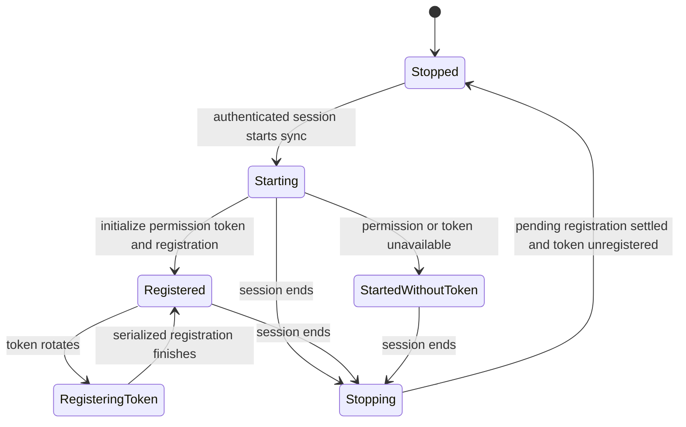
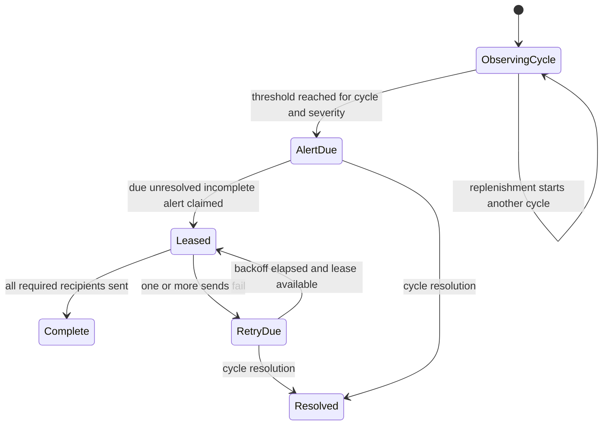
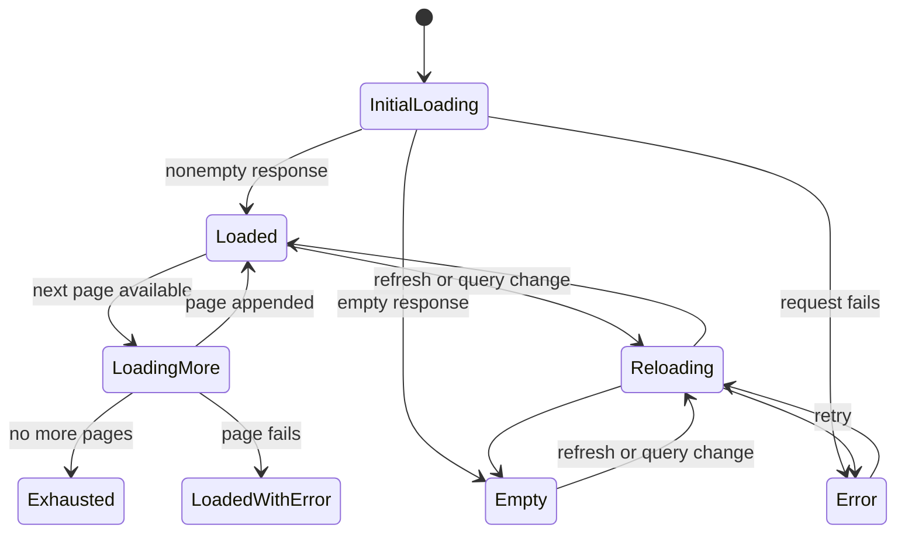

# Infrastructure and supporting UI state machines

[Map index](README.md)

## S01 Push registration synchronized with session

**Implicit; per application session and token.** [PushSessionSync](../../../Bonde-Mobile/lib/core/notifications/push_session_sync.dart), [PushService](../../../Bonde-Mobile/lib/core/notifications/push_service.dart).

`_started`, `_generation`, `_registeredToken`, `_registration`, `_stopping` and the token-refresh subscription encode the lifecycle. Start waits for stopping work; stop invalidates older generations, cancels subscription and waits for registration before unregistering. Push permission, SDK initialization and server token ownership are separate dimensions.

## S02 Cache and shared load

**Implicit; per cache key.** [CacheService](../../src/common/cache/cache.service.ts).

| Transition                  | Guard/event                                | Effect                             |
| --------------------------- | ------------------------------------------ | ---------------------------------- |
| Lookup → hit                | Cached value can be read/decoded           | Return it                          |
| Lookup → miss               | Missing/expired entry or unavailable cache | Read source                        |
| Miss → loading              | No existing inflight promise               | Register loader promise            |
| Miss → joined               | Same key already loading                   | Return shared promise              |
| Loading → cached            | Loader succeeds                            | Store with TTL where available     |
| Loading → failed            | Loader rejects                             | Propagate loader error             |
| Settled → no inflight entry | Promise cleanup                            | Allow a future independent attempt |

Redis availability chooses cached versus uncached behavior. Cache outage is handled as a miss; source-loader failure is not silently converted into successful data.

## S03 Offline store initialization

**Implicit; per HiveOfflineCache instance.** [OfflineCache](../../../Bonde-Mobile/lib/core/storage/offline_cache.dart).

Uninitialized → shared initialization future → box opening → box available. Reads/writes lazily join `init`; concurrent callers wait for the same initialization and box open. Success retains `_box`. Failure propagates to waiting callers and clears the in-flight future so a later call can retry both initialization and opening. This class does not implement an in-memory fallback.

## S04 Account-scoped preferences

**Implicit; per current user and preference store.** [ProfilePreferences](../../../Bonde-Mobile/lib/core/services/profile_preferences.dart).

| Path                                         | Event                               | Effect                                                        |
| -------------------------------------------- | ----------------------------------- | ------------------------------------------------------------- |
| Unbound → account selected → loading → ready | Session/account changes             | Load account-specific values                                  |
| Ready → local/persisted update               | Preference mutation                 | Notify and save the selected preference                       |
| Any → invalidated/rebound                    | Logout or different account         | Advance generation and replace account context                |
| Old loading → ignored                        | Result generation no longer current | Prevent older account data replacing current preference state |

## S05 Global processing and overlay visibility

**Implicit; per processing scope and current route.** [AppProcessing](../../../Bonde-Mobile/lib/core/services/app_processing.dart), [scope widget](../../../Bonde-Mobile/lib/core/widgets/bonde_processing_scope.dart), [overlay](../../../Bonde-Mobile/lib/core/widgets/bonde_processing_overlay.dart).

Work count `0 → positive → 0` determines whether a scope has activity. Route currentness, initial loading and overlay rules determine whether that activity is visible. Scheduled notifications batch state publication. Multiple requests can overlap; finishing one request is not equivalent to clearing all activity.

## S06 AI request usage accounting

**Mixed; per provider usage event.** [AiUsageService](../../src/modules/ai-monitoring/ai-usage.service.ts).

| Transition             | Event                                 | Effect                                                      |
| ---------------------- | ------------------------------------- | ----------------------------------------------------------- |
| New → `PENDING`        | Provider request observed             | Persist request identity/context                            |
| Pending → `SUCCESS`    | Successful response observed          | Record usage/cost facts available from response             |
| Pending → `HTTP_ERROR` | HTTP error response observed          | Record error outcome                                        |
| Pending → `UNKNOWN`    | Fetch throws before a usable response | Preserve uncertainty rather than assert zero provider usage |

This accounting state is distinct from C04 chat completion: one chat attempt can contain several provider calls.

## S07 AI funding cycle and alert delivery

**Implicit/mixed; per provider funding cycle and alert.** [AiMonitoringService](../../src/modules/ai-monitoring/ai-monitoring.service.ts).

Alert state is encoded by `emailComplete`, `resolvedAt`, `nextAttemptAt`, `leaseUntil`, `emailAttempts` and `sentTo`. Claiming uses a two-minute lease. Retry targets recipients not already in `sentTo`; delay increases with attempts and is capped. Funding-cycle identity is rechecked under a lock before an observation creates an alert, preventing an old cycle from describing replenished funds.

The service's process-level `running` flag is a different machine from durable alert leasing.

## S08 Scheduled worker lifecycle

**Implicit; per service instance, not per durable job.** [Chat worker](../../src/modules/chats/chat-worker.service.ts), [billing renewal](../../src/modules/billing/billing-renewal.service.ts), [service purchase runner](../../src/modules/finance/service-purchases.service.ts), [AI monitor](../../src/modules/ai-monitoring/ai-monitoring.service.ts).

Created → initialized/scheduled → idle → running → idle → destroyed. Where present, a `running` boolean suppresses overlapping ticks and a `finally` resets it; module teardown clears timers. Database leases/claims separately control cross-instance work. A process-level flag cannot by itself express durable job ownership.

## S09 Connectivity and socket transport

**Implicit; per service instance.** [ConnectivityService](../../../Bonde-Mobile/lib/core/services/connectivity_service.dart), [socket transport](../../../Bonde-Mobile/lib/core/services/socket_service.dart).

| Machine      | Implemented paths                                                                                                    | Important representation detail                                                            |
| ------------ | -------------------------------------------------------------------------------------------------------------------- | ------------------------------------------------------------------------------------------ |
| Connectivity | Initial assumed online → platform check/event → online/offline; listener error sets offline; dispose cancels streams | Availability is inferred from transport presence, not proof a particular API is reachable  |
| Socket       | Disconnected → connecting → ready; error/done/disconnect → disconnected                                              | Readiness follows handshake; callbacks and generation are scoped to the current connection |

The socket abstraction is available infrastructure; chat is REST-first. Connection readiness is now explicit: disconnected → connecting → ready → disconnected. `isConnected` requires both a current channel and completed handshake; sending before readiness is rejected. Error/done callbacks clear the current connection, and connection-local callbacks plus generation checks prevent an old handshake from changing a replacement connection or undoing disconnect. There is no automatic reconnect state.

## S10 Resource loading, pagination and filtering

**Mixed repeated family; per feed/query generation.** [Cards list](../../../Bonde-Mobile/lib/features/cards/cards_list_cubit.dart), [approvals](../../../Bonde-Mobile/lib/features/approvals/approval_center_cubit.dart), [notifications](../../../Bonde-Mobile/lib/features/notifications/notification_cubit.dart), [Admin useList](../../../Bonde-Admin/src/hooks/use-list.ts), [Admin useApi](../../../Bonde-Admin/src/hooks/use-api.ts).

This is the family diagram: not every member paginates or has a distinct enum variant for each node. Mobile feeds use fields such as page, hasMore, loadingMore and request generations. Query/filter replacement invalidates older requests where generation guards exist. Admin `useApi` cancels application of its effect-driven load on cleanup, while its manually invoked `refresh` has a separate path without that cancellation flag. Retained data can coexist with loading/error; `loading == false` alone does not identify success.

## S11 Optimistic mutations, forms and resource dialogs

**Implicit/mixed repeated family.** [Approval detail](../../../Bonde-Mobile/lib/features/approvals/approval_detail_cubit.dart), [card detail](../../../Bonde-Mobile/lib/features/cards/cards_detail_cubit.dart), [Admin resource table](../../../Bonde-Admin/src/components/marketing/resource-table-panel.tsx), [export menu](../../../Bonde-Admin/src/components/data/export-menu.tsx).

| Family              | Transitions                                                  | Guard/effect                                                  |
| ------------------- | ------------------------------------------------------------ | ------------------------------------------------------------- |
| Optimistic mutation | Loaded → local change → confirmed / restored with error      | Save prior record; apply server result or rollback            |
| Form save           | Editing → validating → saving → saved/error                  | Busy flag and validation gate action                          |
| Destructive dialog  | Closed → selected/confirming → deleting → closed/error       | Selected entity and deletion flag represent lifecycle         |
| Export/share        | Idle → preparing/downloading/sharing → complete/error → idle | Per-action busy flag prevents duplicate action where enforced |

These recur in transaction details/receipts, profile settings, budgets, analytics, session revocation, invite administration and address editing. Their business effects remain governed by their domain APIs; this family only maps request interaction.

## S12 Support ticket and reply workflow

**Mixed; per ticket and per pending action.** [Admin support service](../../src/modules/admin-console/admin-console-support.service.ts), [user support](../../src/modules/profile-hub/profile-hub.service.ts), [ticket UI](../../../Bonde-Admin/src/components/dashboard/ticket-detail-view.tsx).

Ticket status changes through the server's accepted status values. A resolved ticket rejects a new reply. Reply submission and status change each follow idle → submitting → success/error, represented separately in UI state. The server owns the resolved-status guard; a locally enabled reply field is not sufficient authorization.

## S13 Broadcast confirmation

**Implicit; per broadcast form.** [BroadcastCard](../../../Bonde-Admin/src/components/settings/broadcast-card.tsx), [broadcast service](../../src/modules/broadcasts/broadcasts.service.ts).

Editing → confirming → sending → result/error. Confirmation and sending are distinct booleans; form validation precedes the write. Backend delivery fanout is not a durable queued/retrying campaign machine merely because the UI has a sending phase.

## S14 Notifications and push-device records

**Explicit/simple record lifecycles.** [NotificationsService](../../src/modules/notifications/notifications.service.ts), [mobile notification feed](../../../Bonde-Mobile/lib/features/notifications/notification_cubit.dart).

| Aggregate          | Transitions                                                            | Effect                                                              |
| ------------------ | ---------------------------------------------------------------------- | ------------------------------------------------------------------- |
| Notification       | `UNREAD → READ` individually or in bulk                                | Stamp `readAt`; ownership guards record access                      |
| Mobile read action | Unread → optimistic read → accepted/rollback                           | Reconcile feed/unread state on request outcome                      |
| Push device        | Absent → registered/updated → unregistered                             | Associate token/platform with owner, remove registration on request |
| Push delivery      | Created notification → eligible dispatch attempt → best-effort outcome | Notification persistence is separate from remote delivery success   |

S01 owns the client orchestration of token changes and logout, not the notification read status.

## S15 Public marketing submissions

**Implicit; per form attempt plus persisted submission.** [Waitlist form](../../../Bonde-Web/src/components/waitlist/waitlist-form.tsx), [contact form](../../../Bonde-Web/src/components/contact/contact-form.tsx), [MarketingService](../../src/modules/marketing/marketing.service.ts).

| Flow            | Transitions                                                            | Authority/effect                                                     |
| --------------- | ---------------------------------------------------------------------- | -------------------------------------------------------------------- |
| Waitlist UI     | Editing → validation → submitting → joined/already joined/error        | Values, invalid field, submitting, error and result                  |
| Waitlist server | New email → persisted membership; existing email → existing membership | Idempotent membership; confirmation/notification mail is best effort |
| Contact UI      | Editing → submitting → sent/error                                      | Sent flag changes displayed form                                     |
| Contact server  | Accepted → persisted → best-effort inbox notification                  | Persistence success is independent of mail delivery                  |

## S16 Throttling, Redis availability and key caches

**Implicit; per storage backend and per request key.** [Redis throttle](../../src/common/throttling/redis-throttler.storage.ts), [memory throttle](../../src/common/throttling/memory-throttler.storage.ts), [JWKS](../../src/modules/auth/services/jwks.service.ts).

| Machine           | Transitions                                        | Guard/effect                                                                                               |
| ----------------- | -------------------------------------------------- | ---------------------------------------------------------------------------------------------------------- |
| Rate-limit store  | Redis ready ↔ memory fallback                      | Availability chooses store; fallback remains per-process throttling                                        |
| Rate-limit bucket | Absent/expired → counting → blocked → usable/reset | Block when count exceeds limit and block duration is positive; TTL and blockedUntil are distinct deadlines |
| JWKS cache        | Lazy fetch and cached remote key resolution        | Delegated to `jose.createRemoteJWKSet`; the application does not define its own refresh-state enum         |

Fallback changes storage scope; it does not migrate a distributed bucket into memory as one continuous shared counter.

## S17 Delivery address selection and upload persistence

**Implicit record/form workflows.** [DeliveryAddressService](../../src/modules/profiles/delivery-address.service.ts), [address form](../../../Bonde-Mobile/lib/features/profile/presentation/address_form_sheet.dart), [profile UI](../../../Bonde-Mobile/lib/features/profile/presentation/profile_screen.dart), [storage service](../../src/common/storage/storage.service.ts).

| Flow                      | Transitions                                                                                              | Guard/effect                                                                                                           |
| ------------------------- | -------------------------------------------------------------------------------------------------------- | ---------------------------------------------------------------------------------------------------------------------- |
| Default address           | No addresses → first saved default; select another → default changes; delete default → survivor promoted | Exactly one default among surviving addresses; this is an aggregate invariant rather than an enum                      |
| Address form              | Country/region/locality selection → valid details → saving → saved/error                                 | Dependent selections and busy state gate save                                                                          |
| Avatar/upload             | Choose file → request signed upload → upload bytes → save profile path → refresh/error                   | Object upload and profile reference update are separate operations; failure between them does not imply both committed |
| One-time checkout address | No override → item address snapshot                                                                      | Snapshot can be attached without becoming a saved/default address                                                      |

## S18 Biometric prompt and explicit scan phases

**Mixed; per OS prompt and screen.** [BiometricService](../../../Bonde-Mobile/lib/core/services/biometric_service.dart), [face scan](../../../Bonde-Mobile/lib/features/biometrics/presentation/face_recognition_screen.dart), [fingerprint scan](../../../Bonde-Mobile/lib/features/biometrics/presentation/fingerprint_scan_screen.dart).

The screen phases are already explicit: idle → scanning → authenticating → success/failure. OS prompt completion/cancellation supplies transition events; active-prompt counting adds a service-level state used by lifecycle handling. A decorative scan phase, OS authentication success and persisted enrollment metadata are three separate facts. They should not be merged into an inferred server verification state.

## Simple UI state outside the workflow catalog

Password obscuring, balance/card blurring, open menus, selected tabs, carousel indices, theme choice, calendar view and AM/PM selection are small existing state spaces. They are not omitted business processes: their transitions are direct user selection/toggle operations without the asynchronous recovery or cross-record orchestration mapped above. Resend countdowns are time-driven enabled/disabled controls subordinate to A05, not a second credential authority.
